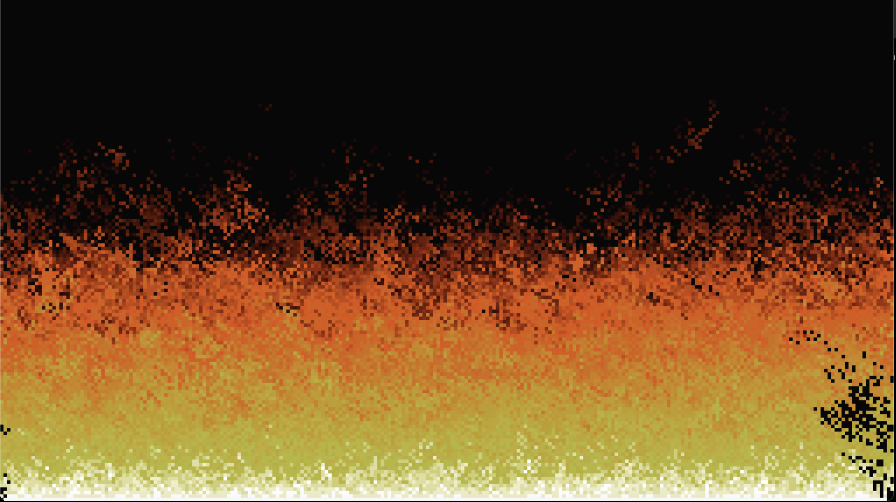

# 🔥 doom-fire

The classic **DOOM fire effect**, written in Python with [pygame](https://www.pygame.org/).



## How it works

The screen is a grid of cells, each holding a "heat" value from `0` (black) to `36` (white).

- The bottom row is kept at max heat.
- Every frame, each cell passes its heat to a neighbouring cell above it, with a random sideways drift and a small chance of cooling.
- Heat values map to a 37-color fire palette, which gives the flames their look.

## Run it

Requires Python 3.13 and [uv](https://docs.astral.sh/uv/).

```bash
git clone <your-repo-url>
cd doom-fire
uv run python src/doom_fire/main.py
```

Close the window to quit.

## Tweaks

In `src/doom_fire/main.py`:

- `cell_size` — bigger number = chunkier pixels
- `set_mode((1280, 720))` — window size

## Credits

Based on the fire effect from the original DOOM, as explained in [Fabien Sanglard's write-up](https://fabiensanglard.net/doom_fire_psx/).